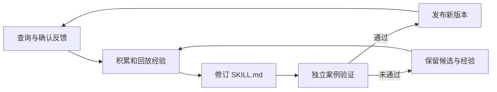

# EvoGate

**通过查询反馈持续优化 Markdown Skill 的 SQL Agent。**

EvoGate 帮助你用自然语言查询 SQLite 数据库，并将日常纠错用于改进后续查询。你可以接入已有的 `SKILL.md`，让 Agent 根据执行轨迹和确认反馈修订其中的操作指导，在独立案例上验证后发布新版本。

本地 Web 工作台提供查询、反馈、Skill 差异查看和版本回退。适合围绕同一业务数据库持续使用：初始 Skill 可以复用，每个数据库的版本独立演进。

## 功能

- **自然语言查询**：结合数据库结构、业务说明与 Skill 生成 SQL，通过字段取值查询和执行反馈检查、调整查询。
- **反馈驱动优化**：积累纠错案例，结合历史错题和成功案例修订 Skill，支持手动发起或按反馈条件自动触发。
- **验证后发布**：比较候选与已有版本的查询表现，通过验证后更新；未通过的候选与原始经验保留供后续修订。
- **可查看、可回退**：查看 Markdown 修改差异、验证结果和历史版本，导出 Skill 或回退到已发布版本。
- **效果对照**：在保留测试案例上比较初始 Skill、进化 Skill 和无 Skill，记录准确率、改善与退化题数及模型调用成本。

## 快速开始

需要 **Python 3.11** 和支持 Chat Completions、工具调用的模型 API。支持 macOS、Linux；Windows 请使用 [WSL2](https://learn.microsoft.com/windows/wsl/install)。

### 1. 安装

推荐使用 [uv](https://docs.astral.sh/uv/getting-started/installation/) 安装依赖：

```sh
git clone https://github.com/filledbox/EvoGate.git
cd EvoGate
uv sync --locked
```

<details>
<summary>使用 pip 安装</summary>

```sh
python3.11 -m venv .venv
source .venv/bin/activate
python -m pip install .
```

安装后，将下文命令中的 `uv run --locked evogate` 替换为 `evogate`。

</details>

### 2. 配置模型

```sh
cp .env.example .env
```

编辑 `.env`，填写 API Key。默认使用 DeepSeek：

```dotenv
DEEPSEEK_API_KEY=your-api-key
```

使用其他兼容服务时，设置以下三项：

```dotenv
EVOGATE_API_KEY=your-api-key
EVOGATE_API_BASE=https://your-provider.example/v1
EVOGATE_MODEL=your-model-name
```

### 3. 接入数据库

将路径替换为你的 SQLite 文件路径：

```sh
uv run --locked evogate --live --env-file .env \
  --workspace workspaces/business \
  --database /absolute/path/business.sqlite --db-id business
```

此命令注册数据库后退出。默认使用内置 SQL Skill；也可以添加 `--skill /path/to/SKILL.md` 接入自己的 Skill，或添加 `--context /path/to/business-notes.txt` 提供字段含义和业务说明。

### 4. 启动工作台

```sh
uv run --locked evogate --live --env-file .env \
  --workspace workspaces/business
```

打开 <http://127.0.0.1:8765>，选择数据库并输入问题。可以在结果页查看生成的 SQL，并提交正确 SQL 和说明作为反馈。后续启动时使用同一工作区即可保留查询、反馈和 Skill 版本。

### 可选：离线演示

无需 API Key，可使用内置销售示例浏览查询、反馈和版本管理流程。演示中的模型回复为预设内容。

```sh
uv run --locked evogate --workspace workspaces/demo
```

## 让 Skill 持续改进

使用过程中，EvoGate 会记录执行轨迹和你确认的纠错。发起进化时，优化器回放近期反馈、历史未解决错题与成功案例，对当前 `SKILL.md` 做局部修改。



开始使用这一流程：

1. 在查询结果页提交已确认的正确 SQL，积累反馈。
2. 导入一组独立验证案例，用于判断 Skill 修改是否值得发布。
3. 在版本页发起后台进化，查看修改差异、验证结果与发布状态。

默认手动触发，也可在界面开启自动进化，按新增反馈数量或同类失败触发更新。后台进化期间可以继续查询，查询使用已发布版本。

候选需要在验证集上相对当前版本达到净改善门槛，且不低于初始 Skill 的成绩，才会发布。SQL 执行成功本身不代表答案正确；验证依赖已确认的参考 SQL。案例格式、触发条件和预算配置见[使用指南](docs/usage.md)。

## 评估效果

可以使用自己的案例或 BIRD 数据集评估 EvoGate。评测按批次提供开发反馈，通过验证集选择版本，再在保留测试集上比较初始 Skill、进化 Skill 与无 Skill 三种设置。

报告包含执行准确率、逐题改善与退化、模型调用及 token 用量，支持缓存与中断恢复。Skill 修改的收益取决于数据库、模型和反馈质量，可通过对照结果判断是否适合你的场景。数据划分、运行命令和报告格式见[评测指南](docs/evaluation.md)。

## 运行与数据

EvoGate 面向单用户本地使用，当前支持 SQLite 和 Markdown 操作指导。SQL 经语法与访问检查后，在只读连接及受限子进程中执行。应用默认监听本机地址，同一工作区请只运行一个应用进程。原生 Windows Python 暂不支持，执行器依赖 Unix 资源限制接口。

模型调用会将问题、数据库结构、业务说明、工具结果、Skill 及相关反馈发送到你配置的 API 服务，并产生调用费用。查询记录与版本保存在本地工作区，评测日志包含模型请求与响应。请勿提交 API Key、业务数据库或未经脱敏的工作区日志。

## 开发与贡献

欢迎通过 Issue 反馈问题、讨论使用场景，或提交 Pull Request。报告问题时，请附上运行环境、复现步骤和已脱敏的错误信息；修改代码时，请补充相关行为的测试。

```sh
uv sync --locked
uv run --locked pytest -q
uv run --locked ruff check src tests scripts
uv build
```

测试使用模拟模型和临时 SQLite 数据库，无需 API Key 或 BIRD 数据。GitHub Actions 自动执行测试、代码检查和构建检查。

主要模块：

| 模块 | 职责 |
|---|---|
| `service.py` | 查询流程、工作区、后台任务与版本发布 |
| `experience.py` | 经验回放、触发条件与调用预算 |
| `optimizer.py`、`patches.py` | Skill 修订、补丁校验与应用 |
| `skills.py` | Markdown Skill 与版本存储 |
| `evaluation.py` | 分批反馈、对照评测与中断恢复 |
| `sql/` | 只读 SQL 执行与结果评分 |

## 致谢与许可

Skill 文档的局部编辑与预算控制设计参考了 [Microsoft SkillOpt](https://github.com/microsoft/SkillOpt/tree/e2edfa9721ce41c98e50fa129da87cf1f53c2f7f)。

原创代码采用 [MIT 许可](LICENSE)。附带的 BIRD EX 评分代码遵循其上游 CC BY-SA 4.0 许可，详见[来源与许可说明](src/evogate/_vendor/NOTICE.md)。BIRD 数据集需单独获取，并遵守其数据许可。
